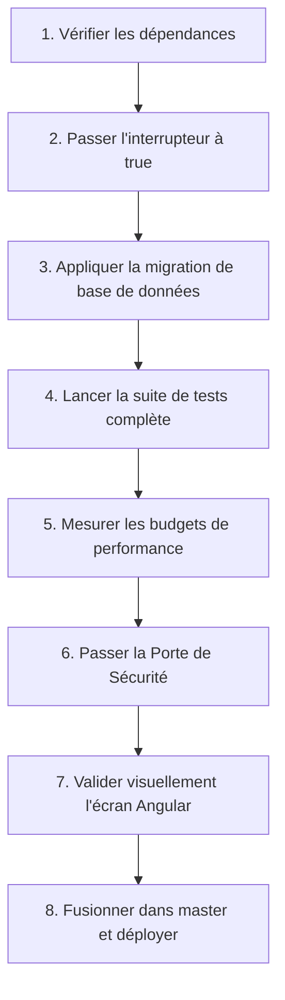

# Référentiel des Modules & Fonctionnalités — Résidence Blue

Ce document détaille la cartographie complète des modules de l'application Résidence Blue, distinguant les modules actifs pour la **Version 1 Minimale** (conçue pour la gestion ultra légère et réactive d'un hôtel de 12 clés à Thiès) et les modules **reportés en Version 2 ou Version 3**.

---

## 1. Tableau des Modules

| Module | ID | Version | État | Dépendances | Maquette associée | Tests associés | Budget de performance |
| :--- | :--- | :--- | :--- | :--- | :--- | :--- | :--- |
| **Accueil & Activité** | `dashboard` | **V1** | **Actif** | *Aucune* | `design/maquettes/tableau_de_bord/` | `dashboard-page.component.spec.ts`, `dashboard-mock.service.spec.ts`, `playwright/dashboard.spec.ts` | < 15 Ko gzip, TTI < 1.0s |
| **Planning des Séjours** | `planning` | **V1** | **Actif** | `rooms` | `design/maquettes/planning_des_r_servations/`, `design/maquettes/modal_nouvelle_r_servation/` | `planning-page.component.spec.ts`, `planning-mock.service.spec.ts`, `reservation-modal.service.spec.ts` | < 25 Ko gzip, 14 jours visibles |
| **Chambres** | `rooms` | **V1** | **Actif** | *Aucune* | `design/maquettes/saly_coastal_boutique_hospitality/` | `rooms.service.spec.ts`, `room-status-card.component.spec.ts`, `status-badge.component.spec.ts`, `action-button.component.spec.ts`, `e2e/rooms.spec.ts`, `e2e/chambres-boutons-pastilles.spec.ts` | < 20 Ko gzip, parc dynamique |
| **Répertoire Clients** | `clients` | **V1** | **Actif** | *Aucune* | `design/maquettes/fiche_profil_client_m._mamadou_diop/` | `client-profile-page.component.spec.ts`, `guest-profile.service.spec.ts` | < 25 Ko gzip, pagination 25 |
| **Facturation & Caisse** | `facturation` | **V1** | **Actif** | `clients` | `design/maquettes/facturation_folio_client_encaissement/` | `facturation-page.component.spec.ts`, `facturation-mock.service.spec.ts` | < 30 Ko gzip, calcul direct |
| **Restaurant & Bar** | `restaurant` | **V1** | **Actif** | *Aucune* | `design/maquettes/point_de_vente_restaurant_la_teranga/` | `restaurant-page.component.spec.ts`, `restaurant-mock.service.spec.ts`, `kitchen-screen.component.spec.ts` | < 35 Ko gzip, tactile réactif |
| **Accès Piscine** | `pool` | **V1** | **Actif** | `facturation` | *Sous-produit POS Restaurant* | `restaurant-mock.service.spec.ts` (PASS-PISCINE) | 0 Ko (intégré au catalogue) |
| **Exports & Rapports** | `exports` | **V1** | **Actif** | *Aucune* | `design/maquettes/rapports_statistiques_financi_res/` | `exports-page.component.spec.ts`, `exports.controller.ts`, `exports-security.e2e-spec.ts` | < 20 Ko gzip, streaming |
| **Housekeeping détaillé** | `housekeeping` | **V2** | **Reporté** | `rooms` | *Formulaire dérivé du style* | `housekeeping.spec.ts` (CI dormant) | < 25 Ko lazy chunk |
| **Maintenance complète** | `maintenance` | **V2** | **Reporté** | `rooms` | `design/maquettes/maintenance_suivi_des_tickets_techniques/` | `maintenance.spec.ts` (CI dormant) | < 30 Ko lazy chunk |
| **Stocks & Économat** | `inventory` | **V2** | **Reporté** | `restaurant` | *Dérivé du style* | `inventory.spec.ts` (CI dormant) | < 25 Ko lazy chunk |
| **Paramètres avancés** | `parametres` | **V2** | **Reporté** | *Aucune* | *Dérivé du style* | `settings.spec.ts` (CI dormant) | < 20 Ko lazy chunk |
| **Fidélité & Marketing** | `marketing_crm`| **V3** | **Reporté** | `clients` | *Dérivé du style* | `marketing.spec.ts` (CI dormant) | < 25 Ko lazy chunk |
| **Passerelle OTAs** | `channel_manager`| **V3** | **Reporté** | `planning`, `rooms`| *Dérivé du style* | `channel-manager.spec.ts` (CI dormant) | < 20 Ko lazy chunk |
| **Comptabilité SYSCOHADA**| `accounting` | **V3** | **Reporté** | `facturation` | *Dérivé du style* | `accounting.spec.ts` (CI dormant) | < 30 Ko lazy chunk |

---

## 2. Tableau des Fonctionnalités Fines (`features`)

| ID | Fonctionnalité | Version | État | Dépendances | Description |
| :--- | :--- | :--- | :--- | :--- | :--- |
| `meteo` | Météo en direct | V2 | **Reporté** | `dashboard` | Widget météo pour la ville de Thiès sur le tableau de bord |
| `actions_prioritaires`| Actions prioritaires | V2 | **Reporté** | `dashboard` | Bloc d'alertes opérationnelles et urgences sur l'accueil |
| `graphique_hebdomadaire`| Graphique hebdomadaire | V2 | **Reporté** | `dashboard`, `facturation` | Graphique d'évolution des recettes prévisionnelles et réelles sur 7 jours |
| `indicateurs_revpar_adr`| Indicateurs RevPAR et ADR | V2 | **Reporté** | `dashboard`, `rooms`, `facturation`| Métriques de rendement hôtelier avancé sur l'accueil |
| `maintenance_complete` | Carnet technique pannes | V2 | **Reporté** | `rooms` | Gestion avancée des tickets et équipements techniques |
| `housekeeping_detaille`| Fiches chambres blanches | V2 | **Reporté** | `rooms` | Plannings d'étage et rotation du linge nominative |
| `parametres_avances` | Paramètres avancés | V2 | **Reporté** | *Aucune* | Écrans d'administration technique et passerelles |
| `stocks` | Gestion des stocks | V2 | **Reporté** | `restaurant` | Fiches techniques, suivi des entrées/sorties d'économat |
| `notifications_auto` | WhatsApp et SMS auto | V2 | **Reporté** | `clients`, `facturation` | Envoi automatique des confirmations et factures clients |
| `scan_pieces_identite` | Scan des pièces d'identité | V2 | **Reporté** | `clients` | Capture caméra et reconnaissance optique passeport/CNI |
| `planning_drag_and_drop`| Glisser-déposer planning| V2 | **Reporté** | `planning` | Déplacement interactif par drag-and-drop des réservations |
| `menu_gestion_avancee` | Menu restaurant avancé | V2 | **Reporté** | `restaurant` | Recadrage photo HD, allergènes multiples, suppléments et export |
| `mobile_complete` | Version mobile complète | V2 | **Reporté** | `dashboard` | Navigation inférieure dédiée mobile (`design/maquettes/tableau_de_bord_mode_clair/`) |
| `roles_avances` | Rôles d'équipe avancés | V2 | **Reporté** | `housekeeping`, `maintenance`, `accounting` | Rôles HOUSEKEEPING, MAINTENANCE et COMPTABLE |
| `planning_vue_14j` | Vue 14 jours planning | V2 | **Reporté** | `planning` | Affichage 14 jours surchargé (remplacé par vue 7 jours sans scroll horizontal en V1) |
| `planning_relogement_auto`| Suggestions relogement | V2 | **Reporté** | `planning` | Relogement automatique et bannières de conflit Tape Chart |
| `planning_stats_avancees`| Statistiques avancées planning | V2 | **Reporté** | `planning` | Métriques d'occupation complexes et infobulles décoratives chargées |

---

## 3. Matrice des Rôles

| Rôle | Version | État V1 | Modules Autorisés | Description |
| :--- | :--- | :--- | :--- | :--- |
| **DIRECTION** | V1 | **Actif** | `dashboard`, `planning`, `rooms`, `clients`, `facturation`, `restaurant`, `pool`, `exports` | Direction générale : accès complet à l'ensemble des modules V1. |
| **RECEPTION** | V1 | **Actif** | `dashboard`, `planning`, `rooms`, `clients`, `facturation`, `restaurant`, `pool`, `exports` | Accueil et réception : réservations, fiches clients, folios, encaissements. |
| **SERVEUR** | V1 | **Actif** | `restaurant` | Service en salle et bar : prise de commande tactile et encaissement direct. |
| **CUISINE** | V1 | **Actif** | `restaurant` (écran `/cuisine`) | Chefs de cuisine et pâtissiers : consultation de l'écran des commandes. |
| **HOUSEKEEPING**| V2 | **Désactivé** | `housekeeping` | Reporté en V2. Non assignable à un utilisateur en V1. |
| **MAINTENANCE** | V2 | **Désactivé** | `maintenance` | Reporté en V2. Non assignable à un utilisateur en V1. |
| **COMPTABLE** | V3 | **Désactivé** | `accounting`, `facturation`, `exports` | Reporté en V3. Non assignable à un utilisateur en V1. |

---

## 4. Garanties Techniques d'Isolation des Modules Reportés

Quand l'interrupteur d'un module est à `false` dans `config/modules.json` :
1. **La route n'existe pas** : Angular Router utilise `moduleCanMatch('moduleId')`. La route est rejetée avant tout téléchargement et bascule sur la redirection par défaut ou 404.
2. **L'entrée de menu n'apparaît pas** : Le composant `SidebarComponent` filtre les entrées en direct via le signal `activeMenuItems` du `ModuleConfigService`.
3. **Le code n'est pas chargé** : Grâce à `canMatch` et au code-splitting esbuild, aucun chunk JavaScript du module reporté n'est récupéré par le navigateur.
4. **Aucune requête API n'est faite** : Côté client, `moduleBlockerInterceptor` intercepte et bloque toute requête réseau vers les préfixes d'API reportés (`/api/housekeeping`, `/api/maintenance`, `/api/stocks`, etc.).
5. **Côté serveur, l'API répond 404** : `ModuleStatusGuard` intercepte les routes annotées `@RequireModule('id')` et les préfixes d'URL, renvoyant un statut HTTP strict `404 Not Found`.
6. **Aucune donnée n'est stockée dans IndexedDB** : `IdbService.put()`, `get()` et `getAll()` vérifient l'état du module associé et ignorent toute opération pour un module inactif.
7. **Rôles protégés** : `RolesGuard` et `isRoleAssignable()` interdisent l'attribution et l'utilisation des rôles des modules reportés (`HOUSEKEEPING`, `MAINTENANCE`, `COMPTABLE`).
8. **Base de données propre** : Les tables SQL des modules reportés sont isolées dans `apps/api/prisma/migrations_deferred/` et ne sont pas exécutées lors de la V1.

---

## 5. Procédure de Réactivation d'un Module Reporté

Pour réactiver un module ou une fonctionnalité reportée (ex. activation du module `maintenance` lors du passage à la V2) :



1. **Vérifier les dépendances** : Consulter `config/modules.json` pour vérifier que tous les modules listés dans le tableau `dependencies` du module sont déjà actifs.
2. **Mettre l'interrupteur à true** :
   Dans `config/modules.json`, passer la clé `"enabled"` du module (et de ses fonctionnalités liées) à `true`.
3. **Appliquer la migration de base de données** :
   Déplacer le script SQL correspondant depuis `apps/api/prisma/migrations_deferred/<nom_module>/` vers `apps/api/prisma/migrations/<timestamp>_<nom_module>/` et exécuter :
   ```bash
   npx prisma migrate dev --name activation_<nom_module>
   ```
4. **Lancer la suite complète de tests** :
   ```bash
   npm run test:unit
   npm run test:integration
   npm run test:security
   npm run test:e2e
   ```
5. **Mesurer les budgets de performance** :
   Vérifier que le chunk lazy du module activé est inférieur à 120 Ko compressé et que la navigation vers l'écran s'effectue en moins de 300 ms.
6. **Passer la Porte de sécurité** :
   Exécuter les attaques automatisées contre les nouvelles routes API (injection, validation DTO, contrôle d'accès RBAC) et consigner le rapport dans `docs/security/<nom_module>.md`.
7. **Valider visuellement l'écran** :
   Comparer l'écran Angular au rendu de référence dans `design/reference/<nom_maquette>.html` (écart maximal < 2%).
8. **Fusionner et livrer** :
   Créer une branche dédiée `feature/reactivation-<nom_module>`, commiter au format Conventional Commits, fusionner sur `master` après validation de la CI.

---

## 6. Tests E2E et Visuels des Modules Désactivés

Les tests unitaires et d'intégration des fonctionnalités reportées **continuent de s'exécuter dans la CI** grâce au mécanisme de surchage dynamique (`FORCE_ALL_MODULES=true` ou `setModuleOverride()`).
En revanche, les tests E2E Playwright de navigation et de rendu graphique complet sont mis en sommeil en V1 et doivent être **relancés obligatoirement lors de la réactivation** :

| Test E2E / Visuel | Fichier de Test | Raison de mise en sommeil V1 | Condition de relance |
| :--- | :--- | :--- | :--- |
| **Tickets de Maintenance E2E** | `apps/web/e2e/maintenance.spec.ts` | Route `/maintenance` désactivée en V1 (canMatch bloque la navigation) | À relancer à la réactivation du module `maintenance` |
| **Feuilles de Housekeeping E2E**| `apps/web/e2e/housekeeping.spec.ts` | Route `/housekeeping` désactivée en V1 | À relancer à la réactivation du module `housekeeping` |
| **Gestion des Stocks E2E** | `apps/web/e2e/stocks.spec.ts` | Route `/stocks` désactivée en V1 | À relancer à la réactivation du module `inventory` |
| **Rendu Mobile Complet** | `apps/web/e2e/mobile-navigation.spec.ts`| Feature flag `mobile_complete` désactivé (barre inférieure) | À relancer à la réactivation de la version mobile V2 |
| **Glisser-déposer Planning** | `apps/web/e2e/planning-dnd.spec.ts` | Feature flag `planning_drag_and_drop` désactivé | À relancer à la réactivation de l'interrupteur V2 |
| **Import / Export Menu Avancé** | `apps/web/e2e/menu-advanced.spec.ts`| Feature flag `menu_gestion_avancee` désactivé | À relancer à la réactivation de l'interrupteur V2 |
| **Fidélité Tableau de Bord Bureau** | `apps/web/e2e/visual-comparison.spec.ts` | Éléments météo, graphiques et RevPAR reportés en V2 | À relancer à la réactivation des widgets Dashboard V2 |
| **Fidélité Tableau de Bord Mobile** | `apps/web/e2e/visual-comparison.spec.ts` | Vue mobile complète reportée en V2 | À relancer à la réactivation de `mobile_complete` |
| **Matrice 12 Chambres Mobile** | `apps/web/e2e/photos-chambres.spec.ts` | Vue matrice mobile complète reportée en V2 | À relancer à la réactivation de `mobile_complete` |
| **Planning 14 Jours E2E** | pps/web/e2e/planning-refonte.spec.ts | Vue 14 jours et défilement horizontal reportés en V2 | À relancer à la réactivation de planning_vue_14j |
| **Planning Relogement Auto** | pps/web/e2e/planning-refonte.spec.ts | Relogement automatique et conflits Tape Chart reportés en V2 | À relancer à la réactivation de planning_relogement_auto |
