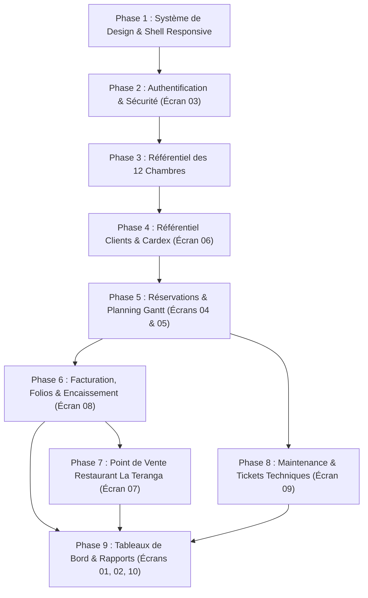

# Ordre d'Intégration Recommandé des Écrans — Résidence Blue (PMS)

Ce document présente la stratégie de développement et l'ordonnancement par phases pour intégrer les écrans issus des maquettes Google Stitch dans l'application Angular, en parfait alignement avec les règles de travail de `AGENTS.md` (une fonctionnalité à la fois, offline-first, sécurité par défaut, tests complets à chaque étape).

---

## 1. Principes Directeurs de l'Ordonnancement

1. **Socle Avant Tout :** Poser d'abord les jetons de design, le shell de navigation (inspiré du `tableau_de_bord`) et le mécanisme d'authentification.
2. **Dépendances Métier Naturelles :** 
   - Une *réservation* dépend de l'existence de *chambres* et de *clients*.
   - Une *facture* dépend d'une *réservation* et de consommations *restaurant*.
   - Le *tableau de bord* et les *rapports* consolident l'ensemble des données créées par les modules précédents.
3. **Respect du Workflow Git :** Chaque phase fera l'objet d'une branche dédiée `feature/<nom>`, avec tests unitaires, intégration, E2E et sécurité validés avant merge.

---

## 2. Feuille de Route d'Intégration en 9 Phases

---

### Phase 1 : Système de Design, Tokens SCSS & Shell Applicatif
- **Objectif :** Poser les bases visuelles et la coquille applicative responsive inspirée du `tableau_de_bord`.
- **Livrables :**
  - Intégration de `design/tokens.scss` dans `apps/web/src/styles.scss`.
  - Polices locales WOFF2 (`Manrope`, `Newsreader`) et icônes Material Symbols locales (sans CDN).
  - Composants Shell : `AppSidebarComponent` (barre sombre 256px), `AppHeaderComponent` (hauteur 80px), `MobileNavComponent` (navigation tactile basse).
- **Justification :** Tous les écrans futurs viendront s'insérer dans ce conteneur commun sans duplication de code.

---

### Phase 2 : Authentification, Sécurité & Rôles
- **Écran concerné :** `Écran 03 — connexion_r_sidence_blue_pms`
- **Livrables :**
  - Page de connexion responsive (visuel Teranga 55% / formulaire 45%).
  - Boutons de sélection rapide de rôle pour le développement/démonstration.
  - Endpoints NestJS `/api/auth/login` et `/api/auth/me` avec tokens JWT sécurisés et cookies HttpOnly.
  - Guards de rôles Angular (`Admin`, `Direction`, `Reception`, `Restaurant`, `Maintenance`, `Housekeeping`).
  - Porte de sécurité : tests d'attaque par brute force et validation des entrées.

---

### Phase 3 : Référentiel des Chambres (12 Clés)
- **Écran concerné :** Écran déduit / manquant (Grille des chambres).
- **Livrables :**
  - Modèle de données Prisma `Room` (12 chambres : Standard 101-106, Deluxe 201-204, Suites 301-302).
  - Gestion des statuts physiques (`AVAILABLE`, `OCCUPIED`, `CLEANING`, `OUT_OF_ORDER`).
  - Tarifs journaliers en FCFA entiers.
  - Composant `RoomCardComponent`.

---

### Phase 4 : Gestion des Clients & Cardex Voyageur
- **Écran concerné :** `Écran 06 — fiche_profil_client_m._mamadou_diop` (+ liste clients).
- **Livrables :**
  - Modèle Prisma `Guest` avec pièces d'identité chiffrées en AES-256-GCM (RGPD / CDP Sénégal).
  - Fiche voyageur avec badges de fidélité (VIP Gold), historique des séjours, panier moyen.
  - Actions rapides de contact (liens WhatsApp et Email).
  - Stockage local IndexedDB des profils clients pour accès hors ligne.

---

### Phase 5 : Moteur de Réservations & Planning Gantt (Tape Chart)
- **Écrans concernés :** 
  - `Écran 04 — modal_nouvelle_r_servation`
  - `Écran 05 — planning_des_r_servations`
- **Livrables :**
  - Formulaire modal en 5 étapes pour la création de réservation avec sélection d'acompte (Wave, Orange Money, Cash, TPE).
  - Détection automatique des chevauchements de dates et bannière d'alerte conflit.
  - Tape Chart interactif sur 14 jours avec défilement horizontal et colonne fixe des 12 chambres.
  - Volet latéral dynamique affichant les détails de la réservation sélectionnée.
  - Gestion des UUIDs clients et de l'idempotence (`Idempotency-Key`).

---

### Phase 6 : Facturation, Folio Client & Encaissement Multicanal
- **Écran concerné :** `Écran 08 — facturation_folio_client_encaissement`
- **Livrables :**
  - Consolidation comptable : Nuitées + extras restaurant + TVA 10% + taxe de séjour légale (1 000 FCFA/nuit/adulte).
  - Module d'encaissement fractionné (Split Payments : Wave, Espèces avec calculateur de rendu, Orange Money, Carte).
  - Déduction de l'acompte initial.
  - Clôture officielle du séjour et libération de la clé pour le ménage.
  - Modèle d'impression PDF du reçu folio avec mention fiscale.

---

### Phase 7 : Point de Vente Restaurant & Bar « La Teranga »
- **Écran concerné :** `Écran 07 — point_de_vente_restaurant_la_teranga`
- **Livrables :**
  - Catalogue tactile de plats locaux (Thiéboudienne, Dibi, Yassa, etc.) avec photos et filtres par catégories.
  - Panneau de commande tactile (affectation à une table T1-T6 ou report direct sur le folio d'une chambre).
  - Dispatch cuisine (KDS) et impression de bon de commande.
  - Fonctionnement autonome hors ligne avec synchronisation différée.

---

### Phase 8 : Maintenance & Tickets Techniques
- **Écran concerné :** `Écran 09 — maintenance_suivi_des_tickets_techniques`
- **Livrables :**
  - Suivi des interventions techniques dans les 12 chambres et les parties communes.
  - Priorisation des urgences (climatisation, plomberie).
  - Verrouillage automatique d'une chambre en « Hors service » sur le Tape Chart lors d'une panne critique.
  - Panneau de détail du ticket avec photos et timeline.

---

### Phase 9 : Tableaux de Bord de Pilotage & Rapports Financiers
- **Écrans concernés :** 
  - `Écran 01 — tableau_de_bord` (Bureau - Directeur)
  - `Écran 02 — tableau_de_bord_mode_clair` (Tablette & Mobile)
  - `Écran 10 — rapports_statistiques_financi_res`
- **Livrables :**
  - Dashboard bureau avec 4 KPIs temps réel, graphique des revenus hebdomadaires et arrivées du jour.
  - Dashboard mobile tactile adapté aux rondes sur le terrain.
  - Module de reporting de direction : RevPAR, ADR, taux d'occupation, ventilation des canaux d'encaissement.
  - Exports comptables PDF et Excel.
